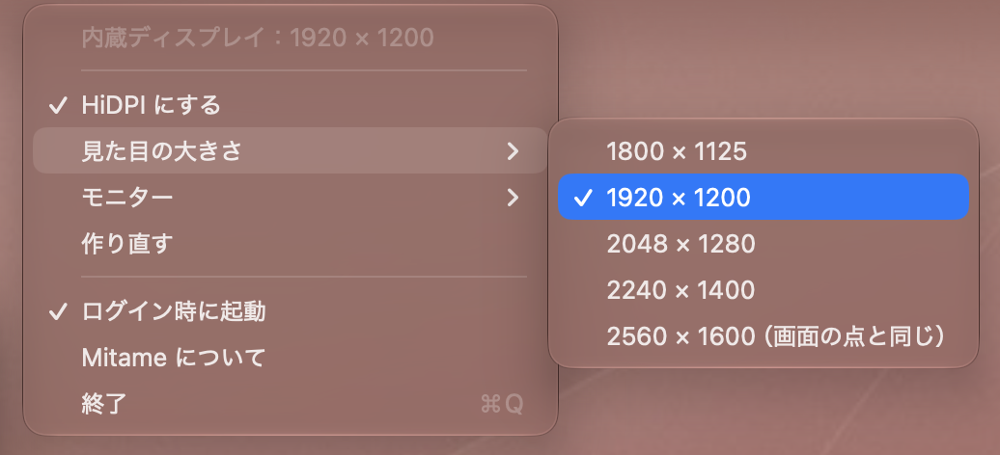

# Mitame

**4K ではない外部モニターでも、Retina のようにくっきりした文字に。**

[English](README.md)

フルHD や WQHD のモニターを Mac につなぐと、文字が少しぼやけて見えることがよくあります。
macOS は、解像度の高い画面でしか、くっきりした HiDPI（Retina）の描き方を使わないためです。
Mitame は、外部モニターをワンクリックで HiDPI にする、小さな無料のメニューバーアプリです。

<p align="center"></p>

名前の **Mitame** は「見た目」から。[Nakami](https://github.com/synchrium/Nakami)（中身）の姉妹アプリです。

> [!NOTE]
> **Mitame はベータ版です。** 今のところ 1 つの環境でしか確かめていません（[確かめた環境](#確かめた環境)）。
> ほかの Mac やモニターで試した方は、[Issues](https://github.com/synchrium/Mitame/issues) で結果を教えてください。とても助かります。

## できること

- **ワンクリック** — メニューバーで「HiDPI にする」を選ぶだけ。数秒で切り替わります
- **見た目の大きさを選べる** — モニター本来の解像度と縦横比（16:9・16:10・21:9 など）に合わせた 7 段階
- **自動で元に戻る** — スリープからの復帰、再起動、ケーブルの抜き差しのあとも HiDPI に戻ります
- **スリープ後にちらつかない** — スリープ中は画面に手を出さず、macOS に戻してもらいます
- **ログイン時に起動**
- **モニターが 2 台以上でも** — どのモニターを HiDPI にするか選べます
- **終了すれば元どおり** — Mitame を終了すると、モニターは元の表示に戻ります
- **日本語と英語**
- **ネットにつながらない** — インターネットに接続せず、データも集めません

## しくみ

Mitame は、選んだ大きさの 2 倍の、目に見えない HiDPI の「仮想ディスプレイ」を作り、
モニターをそこにミラーします。macOS は仮想ディスプレイに 2 倍の細かさで描き、
それをグラフィックスのチップがモニターの大きさに縮めて映すので、文字がくっきりします。
[BetterDisplay](https://github.com/waydabber/BetterDisplay) の HiDPI ミラーと同じやり方です。

Mitame の中心の処理は、Petr Baudis さんの [hidpi-mirror](https://github.com/pasky/hidpi-mirror) をもとにしています。
Mitame は、それをメニューバーのアプリにしたものです。

> [!IMPORTANT]
> Mitame は仮想ディスプレイを作るために、**macOS の非公開の API**（`CGVirtualDisplay`）を使っています。
> そのため Mac App Store では配れず、将来の macOS のアップデートで動かなくなる可能性があります。
> そうなったときも、Mitame を終了すればモニターは元に戻ります。

## 動かすのに必要なもの

- macOS 14 Sonoma 以降
- Apple silicon または Intel の Mac
- 4K **未満**の外部モニター（4K・5K のモニターは macOS がもとから HiDPI にするので、Mitame は要りません）

### 確かめた環境

| Mac | macOS | モニター | 結果 |
| --- | --- | --- | --- |
| MacBook Air（M1） | 27.2 | 24 インチ フルHD（1920 × 1080、16:9）、USB-C → HDMI | 動作 OK（スリープ・再起動・抜き差し・本体を閉じた状態も） |

まだ確かめていないもの：macOS 14〜26、Intel の Mac、WQHD・16:10・ウルトラワイドのモニター、2 台以上のモニター、DisplayLink のアダプター。
試した方は [教えてください](https://github.com/synchrium/Mitame/issues)。

## 入れ方

1. [リリースのページ](https://github.com/synchrium/Mitame/releases) から `Mitame-x.y.zip` をダウンロードします（一番上が最新です）。
2. zip をダブルクリックして、`Mitame.app` を取り出します。
3. **Finder で `Mitame.app` を「アプリケーション」フォルダへドラッグします。**
   （Finder で移してください。移さずに開くと、macOS は一時的な場所から動かします）

### はじめて開くとき

Mitame は無料で、Apple の公証（有料の Apple Developer Program が必要）を受けていないため、
はじめて開くときだけ、macOS が確認を求めます。

1. 「アプリケーション」フォルダの Mitame をダブルクリックします。**「"Mitame" は開いていません」** と出たら **「完了」** を押します。
   （「ゴミ箱に入れる」は押さないでください）
2. **システム設定 → プライバシーとセキュリティ** を開き、下の **「セキュリティ」** までスクロールします。
3. **「お使いのMacを保護するために"Mitame"がブロックされました。」** の横の **「このまま開く」** を押します。
4. **「"Mitame"を開きますか?」** と出たら **「このまま開く」** を押して、Mac のユーザー名とパスワードを入れます。

これで、次からは普通に開けます。Mitame は Dock ではなく、メニューバーに出ます。

<details>
<summary>ターミナルを使う場合</summary>

ターミナルに慣れている方は、このコマンドでも同じことができます。

```sh
xattr -dr com.apple.quarantine /Applications/Mitame.app
```

</details>

### 新しいバージョンにするとき

Mitame を終了してから、「アプリケーション」フォルダの `Mitame.app` を新しいものに置き換えます。
**macOS は新しいバージョンを別のアプリとして扱うので、[はじめて開くとき](#はじめて開くとき) の手順がもう一度必要です。**

## 使い方

メニューバーのモニターのアイコンを押します。

| メニュー | すること |
| --- | --- |
| **HiDPI にする** | モニターの HiDPI をオン／オフします |
| **見た目の大きさ** | 画面に表示される大きさ。数字が大きいほど広く使えます（文字は小さくなります）。「モニターと同じ」は今の大きさのまま、くっきりだけさせます |
| **モニター** | モニターが 2 台以上のときだけ出ます。どれを HiDPI にするか選びます |
| **作り直す** | 仮想ディスプレイを作り直します。表示がおかしいときに試してください |
| **ログイン時に起動** | ログインしたときに Mitame を起動します。HiDPI がオンだったら、またオンにします |

Mitame は選んだ設定を覚えています。HiDPI がオンのままモニターを抜いても、挿し直せば自動でオンに戻ります。

## うまくいかないとき

- **Mitame を終了します**（メニューバーのアイコン → **終了**）。モニターは元の解像度に戻ります。
- メニューバーのアイコンが見えないときは、**アクティビティモニタ** で **Mitame** を選んで ✕ ボタンで終了します。
  仮想ディスプレイも Mitame と一緒に消えます。
- モニターの設定は、いつでも **システム設定 → ディスプレイ** で確かめたり変えたりできます。

## ご意見・ご感想

Mitame はベータ版です。いただいた声をもとに 1.0 を作ります。[Issues](https://github.com/synchrium/Mitame/issues) で気軽に教えてください。

- あなたの Mac とモニターで動いたかどうか（Mac の機種・macOS のバージョン・モニターの解像度も書いてもらえると助かります）
- 不具合や、わかりにくかったところ
- アイコンの感想 🙂

## ソースからビルドする

Xcode 27 以降が必要です。

1. このリポジトリをクローンして、`Mitame.xcodeproj` を開きます。
2. **Signing & Capabilities** で、Mitame のターゲットに自分のチームを選びます。
3. ⌘R を押します。

リリースと同じビルド（アドホック署名・Universal・アプリに個人の情報を入れない）を作るには、次を実行します。

```sh
Scripts/build-dist.sh
```

仮想ディスプレイの処理は `Mitame/Engine/MitameEngine.m` にあり、`hidpi-mirror.m` をもとにしています。

## 感謝

[hidpi-mirror](https://github.com/pasky/hidpi-mirror) を作った **Petr Baudis** さんに、心から感謝します。
スリープやつなぎ直し、WindowServer のくせを丁寧に扱った処理のおかげで、Mitame は安定して動いています。

## ライセンス

[MIT License](LICENSE)。Mitame には hidpi-mirror（MIT License、© 2026 Petr Baudis）のコードが入っていて、そのライセンスも [LICENSE](LICENSE) に入れてあります。

Mitame は現状のまま提供され、いかなる保証もありません。使ったことで生じた損害について、作者は責任を負いません。
詳しくは [LICENSE](LICENSE) をご覧ください。
