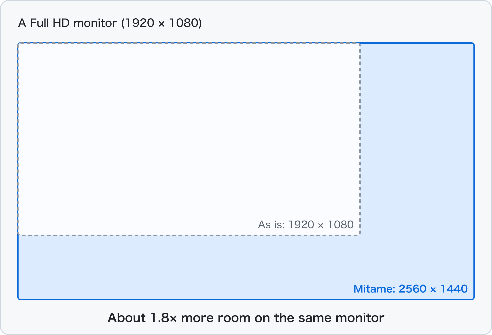
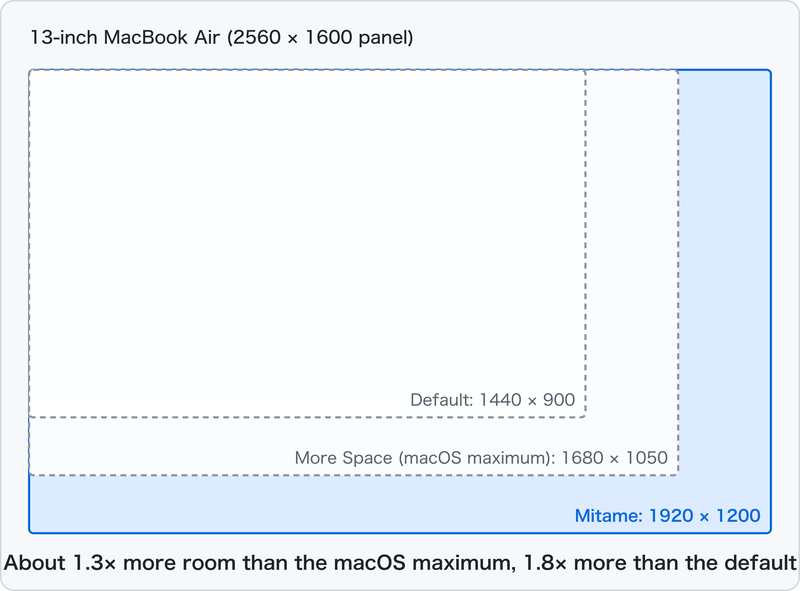
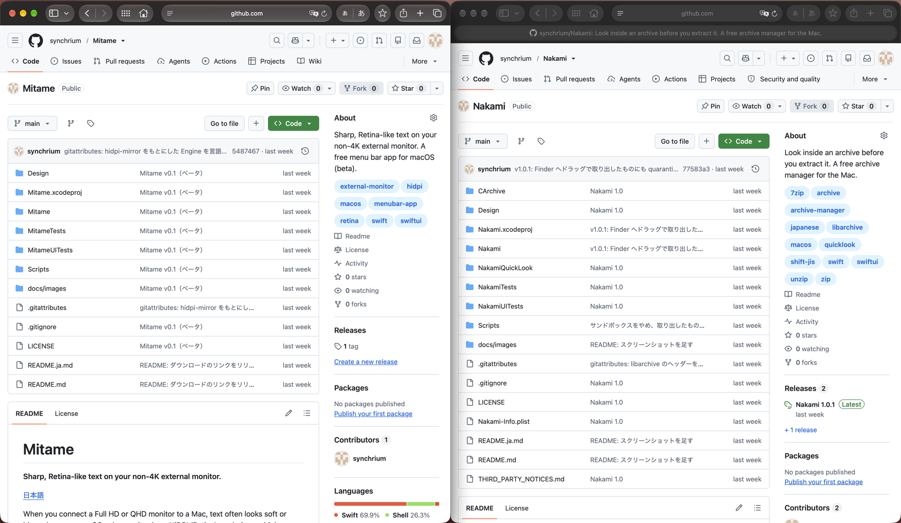

# Mitame

**Sharp, Retina-like text on your non-4K monitor — and more room on your MacBook's screen.**

[日本語](README.ja.md)

When you connect a Full HD or QHD monitor to a Mac, text often looks soft or blurry,
because macOS only uses its sharp HiDPI (Retina) rendering on high-resolution screens.
Mitame is a small, free menu bar app that turns on HiDPI for your external monitor with one click.
It can also give your MacBook's built-in display more room than the macOS settings allow (up to 1920 × 1200 on a 13-inch MacBook Air), while keeping text sharp.

<p align="center"></p>

*Mitame* (見た目) is Japanese for "how things look". It is a sister app of [Nakami](https://github.com/synchrium/Nakami) ("contents").

> [!NOTE]
> **Mitame is in beta.** It has only been tested on one setup so far (see [Tested setups](#tested-setups)).
> If you try it on another Mac or monitor, please tell us how it went in [Issues](https://github.com/synchrium/Mitame/issues) — it helps a lot.

## Features

- **One click** — choose **HiDPI** in the menu bar, and your monitor switches in a few seconds
- **More room** — even on a Full HD monitor, you can choose to look like 2560 × 1440 (the same room as QHD, about 1.8×)
- **More room on your MacBook, too** <sup>v0.2</sup> — use the built-in display with more space than macOS's **More Space** setting (five sizes from 1800 × 1125 to 2560 × 1600 on a 13-inch MacBook Air)
- **Choose how big things look** — for external monitors, seven sizes based on the monitor's own resolution and shape (16:9, 16:10, 21:9, …)
- **Keeps your main display** <sup>v0.2</sup> — if you use the built-in display as the main display and the monitor as an extended one, Mitame keeps that arrangement
- **Comes back by itself** — after sleep, restarting your Mac, or unplugging and plugging in the cable
- **No flicker** — Mitame leaves the screen alone while the Mac sleeps and lets macOS restore it, and sets the external monitor to a flicker-free mode before mirroring
- **Open at Login**
- **Choose which display to make HiDPI** — with two or more monitors, or the built-in display (one display at a time)
- **Quit to undo** — when you quit Mitame, your monitor goes back to how it was
- **English and Japanese**
- **Works offline** — Mitame does not connect to the internet and does not collect any data

<p align="center"></p>
<p align="center"></p>
<p align="center"><br><sub>A 13-inch MacBook Air at 1920 × 1200 with Mitame. Two browser windows side by side, with room to spare</sub></p>

## How it works

Mitame creates an invisible HiDPI "virtual display" that is twice the size you choose,
and mirrors your monitor onto it. macOS draws everything at 2× on the virtual display,
and the graphics chip shrinks the picture to fit your monitor — so text comes out sharp.
This is the same technique that [BetterDisplay](https://github.com/waydabber/BetterDisplay) uses for its HiDPI mirroring.

The core of Mitame comes from [hidpi-mirror](https://github.com/pasky/hidpi-mirror) by Petr Baudis.
Mitame adds a menu bar app around it.

> [!IMPORTANT]
> Mitame uses a **private macOS API** (`CGVirtualDisplay`) to create the virtual display.
> This is why Mitame is not on the Mac App Store, and a future macOS update could stop it from working.
> If that happens, quit Mitame and your monitor goes back to normal.

## Requirements

- macOS 14 Sonoma or later
- A Mac with Apple silicon or an Intel processor
- An external monitor that is **not** 4K or higher (4K and 5K monitors are already HiDPI in macOS, so Mitame is not needed), or a MacBook's built-in display

### Tested setups

| Mac | macOS | Monitor | Result |
| --- | --- | --- | --- |
| MacBook Air (M1) | 27.2 | 24" Full HD (1920 × 1080, 16:9), USB-C to HDMI | Works, including sleep, restart, unplugging, and lid closed |
| MacBook Air (M1) | 27.2 | Built-in display (13.3", 2560 × 1600) | Works (1800 × 1125 to 2560 × 1600, and switching with the external monitor) |

Not tested yet: macOS 14–26, Intel Macs, built-in displays of 14-inch and larger MacBooks, QHD / 16:10 / ultrawide monitors, two or more monitors, DisplayLink adapters.
If you try one of these, please [let us know](https://github.com/synchrium/Mitame/issues).

## Install

1. Download `Mitame-x.y.zip` from the [Releases page](https://github.com/synchrium/Mitame/releases) (the newest one is at the top).
2. Double-click the zip file to extract `Mitame.app`.
3. **Drag `Mitame.app` to the Applications folder in the Finder.**
   (Please move it with the Finder. If you open it without moving it, macOS runs it from a temporary location.)

### Opening Mitame for the first time

Mitame is free and is not notarized by Apple (that requires a paid Apple Developer membership),
so macOS asks you to confirm before opening it the first time.

1. Double-click Mitame in the Applications folder. You will see **"Mitame" Not Opened**. Click **Done**.
   (Do not click "Move to Trash".)
2. Open **System Settings → Privacy & Security** and scroll down to the **Security** section.
3. Next to **"Mitame" was blocked to protect your Mac**, click **Open Anyway**.
4. Click **Open Anyway** again, and enter your password (or use Touch ID).

After this, Mitame opens normally. It appears in the menu bar (not in the Dock).

<details>
<summary>Using Terminal instead</summary>

If you are comfortable with Terminal, this command does the same thing as the steps above:

```sh
xattr -dr com.apple.quarantine /Applications/Mitame.app
```

</details>

### Updating to a new version

Quit Mitame, and replace `Mitame.app` in the Applications folder with the new one.
**macOS treats each new version as a new app, so you need to do the steps in
[Opening Mitame for the first time](#opening-mitame-for-the-first-time) again.**

## How to use

Click the monitor icon in the menu bar.

| Menu | What it does |
| --- | --- |
| **HiDPI** | Turns HiDPI on or off for your monitor |
| **Looks Like** | How big things look. Bigger numbers fit more on the screen (smaller text). For an external monitor, "Same as Monitor" keeps the size you have now, only sharper. For the built-in display, "Same as Panel Pixels" gives the most room |
| **Monitor** | Shown when an external monitor is connected. Chooses which display (including the built-in one) to make HiDPI. Mitame remembers the size for each display |
| **Rebuild** | Creates the virtual display again. Try this if the screen ever looks wrong |
| **Open at Login** | Starts Mitame when you log in. If HiDPI was on, it turns on again |

Mitame remembers your choices. If you unplug the monitor while HiDPI is on, Mitame waits and turns it back on when you plug it in.
If you chose the built-in display and close the lid, it comes back when you open it.

## If something goes wrong

- **Quit Mitame** (menu bar icon → **Quit Mitame**). Your monitor goes back to its normal resolution.
- If the menu bar icon is not visible, open **Activity Monitor**, select **Mitame**, and click the ✕ button to quit it.
  The virtual display goes away together with Mitame.
- You can always check or change your monitor in **System Settings → Displays**.

## Feedback

Mitame is in beta, and your feedback shapes version 1.0. Please open an [issue](https://github.com/synchrium/Mitame/issues) for:

- Whether it worked on your Mac and monitor (please include the Mac model, macOS version, and monitor resolution)
- Bugs and anything that felt confusing
- What you think of the icon 🙂

## Build from source

You need Xcode 27 or later.

1. Clone this repository and open `Mitame.xcodeproj`.
2. In **Signing & Capabilities**, choose your own team for the Mitame target.
3. Press ⌘R.

To make the same build as the releases (ad-hoc signed, Universal, with no personal information in the app), run:

```sh
Scripts/build-dist.sh
```

The virtual display code is in `Mitame/Engine/MitameEngine.m`, based on `hidpi-mirror.m`.

## Thanks

Huge thanks to **Petr Baudis** for [hidpi-mirror](https://github.com/pasky/hidpi-mirror).
Its careful handling of sleep, reconnects, and WindowServer quirks is what makes Mitame reliable.

## License

[MIT License](LICENSE). Mitame includes code from hidpi-mirror (MIT License, © 2026 Petr Baudis); its license is included in [LICENSE](LICENSE).

Mitame is provided as is, without warranty of any kind. The author is not liable for any damages arising from its use.
See [LICENSE](LICENSE) for details.
